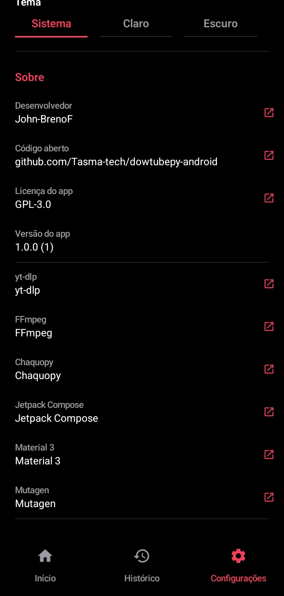

# Dowtuber

Aplicativo Android para download de vídeos e áudios de forma simples e rápida.

## Capturas de Tela

<table>
  <tr>
    <td align="center"></td>
    <td align="center"></td>
    <td align="center"></td>
  </tr>
</table>

## Funcionalidades

- Download de vídeos em até 1080p
- Extração de áudio.
- Interface minimalista.
- Motor baseado em `yt-dlp`.

## Tecnologias

- Python / yt-dlp
- Android (Jetpack Compose / Kotlin)
